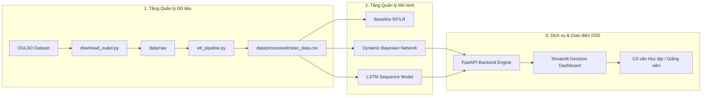

# Hệ Hỗ Trợ Ra Quyết Định (DSS) Cảnh Báo Nguy Cơ Học Tập Sinh Viên

> **Đồ án môn học:** Hệ thống Hỗ trợ Ra quyết định (*Decision Support Systems* - `IS254.R11`)  
> **Trường:** Trường Đại học Công nghệ Thông tin – ĐHQG-HCM (UIT)  
> **Giảng viên hướng dẫn:** Thầy Nguyễn Hồ Duy Trí  
> **Nhóm thực hiện (Nhóm 8):**  
> - **Bạch Hồ Bắc** – MSSV: `23520086`  
> - **Đặng Công An** – MSSV: `23520002`  

---

## 📌 Giới thiệu tổng quan

Trong môi trường giáo dục đại học và học trực tuyến, việc phát hiện chậm trễ sinh viên có nguy cơ rớt môn hoặc bỏ học (sau khi đã có điểm giữa kỳ hoặc cuối kỳ) khiến các biện pháp can thiệp của cố vấn học tập bị giảm hiệu quả.

Dự án này xây dựng một **Hệ Hỗ trợ Ra quyết định (Decision Support System - DSS)** nhằm phát hiện sớm sinh viên có nguy cơ học tập theo tiến độ tuần học trên bộ dữ liệu giáo dục công khai **OULAD (Open University Learning Analytics Dataset)**. Hệ thống kết hợp hai trường phái mô hình:
1. **Dynamic Bayesian Network (DBN):** Cung cấp khả năng suy luận xác suất trong điều kiện thiếu thông tin và giải thích nhân quả minh bạch (Explainable AI).
2. **LSTM (Long Short-Term Memory):** Nắm bắt chuỗi hành vi học tập và tương tác theo thời gian.
3. **Mô hình đối chứng (Baseline):** Random Forest / Logistic Regression làm chuẩn so sánh.
4. **Hệ thống phần mềm DSS:** Đóng gói mô hình qua **FastAPI** và trực quan hóa qua **Dashboard Streamlit** phân loại 3 mức nguy cơ (`Low`, `Medium`, `High`) hỗ trợ cố vấn học tập đưa ra quyết định can thiệp kịp thời.

---

## 🏗️ Kiến trúc Hệ thống DSS



---

## 📂 Cấu trúc thư mục Repository

Cấu trúc dự án được chuẩn hóa theo mô hình khoa học dữ liệu và công nghệ phần mềm:

```text
IS254.R11/
├── .gitignore                    # Cấu hình bỏ qua file lớn (>100MB), cache, venv
├── README.md                     # Tài liệu tổng quan & hướng dẫn chạy dự án
├── requirements.txt              # Danh sách thư viện phụ thuộc Python
│
├── docs/                         # Tài liệu kế hoạch & đề cương đồ án
│   ├── DSS_plan.docx             # Bản kế hoạch đồ án chi tiết (Word)
│   ├── DSS_plan.txt              # Trích xuất nội dung văn bản kế hoạch
│   └── README.md                 # Tóm tắt kế hoạch & mục tiêu đồ án
│
├── data/                         # Quản lý dữ liệu dự án
│   ├── README.md                 # Từ điển dữ liệu (28 thuộc tính) & quy trình ETL
│   ├── raw/                      # Dữ liệu OULAD thô (được tải tự động từ Figshare)
│   │   └── .gitkeep
│   └── processed/                # Dữ liệu sạch sau tiền xử lý (clean_data.csv)
│       ├── clean_data.csv        # 173.861 dòng x 28 cột (~22.5 MB)
│       └── .gitkeep
│
├── src/                          # Toàn bộ mã nguồn chính của dự án
│   ├── __init__.py
│   ├── data/                     # Scripts thu thập & xử lý dữ liệu
│   │   ├── __init__.py
│   │   ├── download_oulad.py     # Tự động tải OULAD từ Figshare về data/raw/
│   │   └── etl_pipeline.py       # Pipeline làm sạch, chống data leakage, tạo đặc trưng
│   ├── models/                   # Xây dựng & huấn luyện mô hình (DBN, LSTM, Baseline)
│   │   └── __init__.py
│   ├── api/                      # Backend API suy luận thời gian thực (FastAPI)
│   │   └── __init__.py
│   └── dashboard/                # Giao diện người dùng hỗ trợ ra quyết định (Streamlit)
│       └── __init__.py
│
└── notebooks/                    # Jupyter Notebooks phục vụ EDA và thử nghiệm
    ├── README.md                 # Hướng dẫn & danh mục notebooks
    └── .gitkeep
```

---

## ⚡ Hướng dẫn cài đặt và Chạy nhanh (Quick Start)

### 1. Yêu cầu môi trường
- Python `>= 3.10` (Khuyến nghị Python `3.10` - `3.14`)
- Dung lượng ổ đĩa trống: tối thiểu `2 GB` để lưu trữ dữ liệu OULAD thô và bảng tiền xử lý.

### 2. Thiết lập môi trường ảo

```bash
# Clone repository về máy
git clone <URL_REPO_CUA_BAN>
cd IS254.R11

# Tạo môi trường ảo (virtual environment)
python -m venv .venv

# Kích hoạt môi trường ảo:
# Trên Windows:
.venv\Scripts\activate
# Trên macOS / Linux:
source .venv/bin/activate

# Cài đặt các thư viện cần thiết
pip install -r requirements.txt
```

### 3. Tải bộ dữ liệu OULAD

Script `download_oulad.py` sẽ tự động tải file zip từ kho lưu trữ Figshare chính thức (~44.5 MB) và giải nén ra 7 bảng CSV trong `data/raw/`:

```bash
python src/data/download_oulad.py
```

### 4. Thực thi ETL Pipeline sinh `clean_data.csv`

Chạy pipeline để làm sạch dữ liệu, xử lý sinh viên hủy môn, loại bỏ rò rỉ thông tin tương lai (*data leakage*) và tính toán các đặc trưng tiến độ tích lũy:

```bash
python src/data/etl_pipeline.py
```

Kết quả đầu ra:
- **Đường dẫn:** `data/processed/clean_data.csv`
- **Quy mô:** **173.861 dòng**, **28 cột thuộc tính** (Thỏa mãn yêu cầu $\ge 40.000$ dòng của môn học IS254).
- **Tốc độ xử lý:** Khoảng **1 – 2 giây** nhờ cơ chế tối ưu vector hóa của pandas/numpy.

---

## 📊 Tóm tắt Dữ liệu Huấn luyện (`clean_data.csv`)

| Nhóm thuộc tính | Số cột | Danh sách các cột tiêu biểu |
| :--- | :---: | :--- |
| **Định danh & Môn học** | 4 | `id_student`, `code_module`, `code_presentation`, `id_assessment` |
| **Nhân khẩu học & Nền tảng** | 8 | `gender`, `region`, `highest_education`, `imd_band`, `age_band`, `studied_credits`, `num_of_prev_attempts`, `disability` |
| **Bài đánh giá hiện tại** | 9 | `assessment_type`, `weight`, `assessment_order`, `submission_week`, `submission_delay`, `is_late`, `score`, `is_banked`, `is_passed_assessment` |
| **Tiến độ tích lũy (Cảnh báo sớm)** | 5 | `prior_assessments_count`, `prior_avg_score`, `prior_late_count`, `prior_fail_count`, `score_progress` |
| **Nhãn mục tiêu (Target)** | 2 | `final_result`, `at_risk` (1: Nguy cơ Rớt/Bỏ học, 0: Đậu/Xuất sắc) |

*Chi tiết định nghĩa từng trường dữ liệu xem tại [data/README.md](data/README.md).*

---

## 🛡️ Lưu ý quan trọng khi đẩy lên GitHub

1. **Giới hạn kích thước file:** File `studentVle.csv` gốc nặng hơn **432 MB** (vượt quá giới hạn 100 MB của GitHub). File `.gitignore` của dự án đã được cấu hình sẵn để **tự động bỏ qua** các file dữ liệu thô trong `data/raw/`.
2. **Người tải repo về:** Chỉ cần chạy lệnh `python src/data/download_oulad.py` và `python src/data/etl_pipeline.py` là có đầy đủ toàn bộ dữ liệu gốc và dữ liệu sạch mà không cần upload file dung lượng lớn lên Git.
3. **Dữ liệu sạch:** File `data/processed/clean_data.csv` nặng khoảng 22.5 MB (nằm trong ngưỡng an toàn < 100 MB). Bạn có thể lựa chọn đẩy file này lên để người khác clone về có thể chạy ngay mô hình, hoặc bỏ qua tùy theo nhu cầu.

---

## 🗓️ Kế hoạch thực hiện đồ án (Roadmap)

- [x] **Tuần 1:** Nghiên cứu bài báo tiền đề, khảo sát dữ liệu OULAD, xây dựng kế hoạch đồ án (`docs/DSS_plan.docx`).
- [x] **Tuần 2:** Xây dựng script tải tự động và hoàn thiện ETL Data Pipeline (`src/data/etl_pipeline.py`) tạo bảng 173k dòng sạch.
- [ ] **Tuần 3:** Huấn luyện mô hình đối chứng (Baseline: Random Forest/Logistic Regression) và xây dựng mạng Dynamic Bayesian Network (DBN) qua thư viện `pgmpy`.
- [ ] **Tuần 4:** Huấn luyện mạng nơ-ron LSTM với kỹ thuật masking và so sánh hiệu năng theo các mốc tuần $T \in \{2, 8, 16\}$.
- [ ] **Tuần 5:** Xây dựng dịch vụ suy luận REST API với **FastAPI**.
- [ ] **Tuần 6:** Phát triển giao diện bảng điều khiển **Streamlit Dashboard** hỗ trợ cảnh báo sớm và giải thích nguyên nhân rủi ro cho cố vấn học tập.
- [ ] **Tuần 7:** Đóng gói Docker, tổng kết thực nghiệm và hoàn thiện báo cáo đồ án.

---

## 📖 Tài liệu tham khảo

1. **OULAD Dataset:** Kuzilek, J., Hlosta, M., & Zdrahal, Z. (2017). *Open University Learning Analytics Dataset*. Scientific Data, 4, 170171. DOI: [10.1038/sdata.2017.171](https://doi.org/10.1038/sdata.2017.171)
2. **Nghiên cứu tiền đề:** Tan et al. (2026). *Early Prediction of Student At-Risk Status using Dynamic Bayesian Networks*.
